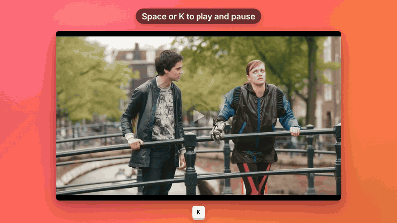
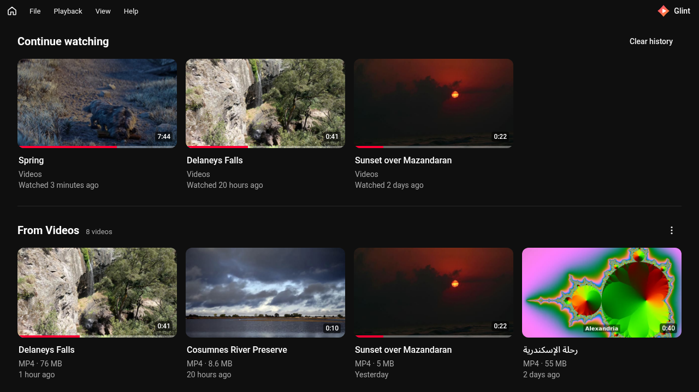
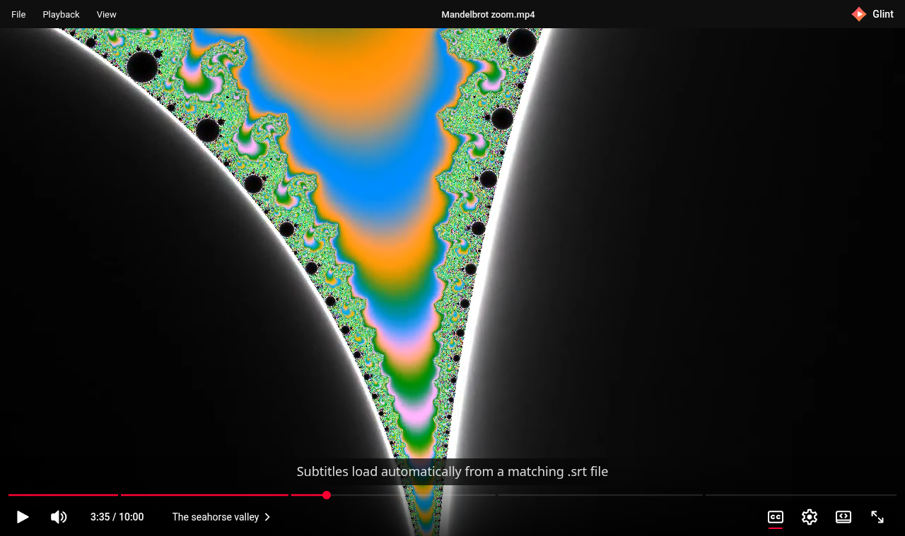

<div align="center">


# Glint

**A fast, simple video player for Windows that looks and feels like the YouTube player.**

[](https://github.com/Adham-ELtawil/glint/releases/latest)
[](https://github.com/Adham-ELtawil/glint/releases)
[](https://github.com/Adham-ELtawil/glint/actions/workflows/ci.yml)
[](LICENSE)




[](https://github.com/Adham-ELtawil/glint/releases/latest)

Free and open source · Windows 10 and 11 · about 2.5 MB

</div>

Open a video and the same control bar, shortcuts, and animations you already know from YouTube are there. Glint opens to your **Continue watching** list and your video folders, so the thing you were watching is one click away. No setup, no ads, no account, and no telemetry.



## Contents

- [Features](#features)
- [Download and install](#download-and-install)
- [Using Glint](#using-glint)
- [Keyboard shortcuts](#keyboard-shortcuts)
- [Supported formats](#supported-formats)
- [FAQ and troubleshooting](#faq-and-troubleshooting)
- [Roadmap](#roadmap)
- [Development](#development)
- [Contributing](#contributing)
- [License](#license)

## Features

- **Home screen.** Glint opens to **Continue watching**, with a thumbnail and progress bar for everything you were in the middle of, and a shelf for each of your video folders, starting with Windows' **Videos** folder.
- **YouTube-style player.** Red progress bar with buffering, hover time, and chapter segments. Play/pause, volume with a hover slider, time, chapter title, captions, settings, theater, and fullscreen. The controls fade while you watch.
- **YouTube keyboard shortcuts.** K, J, L, the arrow keys, 0–9, `<` and `>`, and the rest. See [Keyboard shortcuts](#keyboard-shortcuts).
- **Remembers where you stopped.** Position, volume, mute, and speed are saved for each file.
- **Subtitles.** A matching `.srt` or `.vtt` next to the video loads on its own. You can also load one from **File → Open subtitle…**.
- **Chapters.** Add a `.chapters.json` or `.chapters.vtt` file next to the video and the progress bar splits into chapters.
- **Folder playlist.** The other videos in the same folder become a playlist. **Next** (Shift+N) plays the next one.
- **One window.** Opening another file from Explorer sends it to the Glint window that is already open.
- **Private.** History, thumbnails, and settings stay on your PC. **View → Clear watch history** removes them.
- **Automatic updates.** From 0.1.6 on, Glint checks for a new version when it starts and offers to install it in one click. **Help → Check for updates…** checks right away.
- **Animations always on.** The play/pause animations still run when Windows **Animation effects** is turned off.



## Download and install

1. Go to the [latest release](https://github.com/Adham-ELtawil/glint/releases/latest) and download `Glint_<version>_x64-setup.exe` (about 3.3 MB). Glint runs on 64-bit Windows 10 and 11.
2. Run it. Glint installs for your user account only, so it doesn't ask for administrator rights.
3. Open Glint from the Start menu, or right-click a video and choose **Open with → Glint**.

> [!IMPORTANT]
> **"Windows protected your PC."** Glint's installer isn't code-signed yet, so the first time you run it Microsoft Defender SmartScreen shows this blue warning. That's expected for new, unsigned apps, not a sign that something is wrong. Click **More info**, then **Run anyway**.
>
> To check the download first, compare it with the SHA-256 in the release notes (from 0.1.5 on there is also a `.sha256` file). In PowerShell: `Get-FileHash .\Glint_<version>_x64-setup.exe`. All of Glint's source code is in this repository, and releases are built from it by the [Release workflow](.github/workflows/release.yml).

**WebView2.** Glint draws its window with Microsoft Edge WebView2. It is already installed on Windows 11 and on most Windows 10 PCs. If it is missing, the installer downloads and installs it for you, which needs an internet connection.

**Updating.** From 0.1.6 on, Glint tells you when a new version is out: click **Update** and it downloads, installs, and restarts on its own. Updates are signed, and Glint refuses any download that wasn't signed with Glint's release key. To update from 0.1.5 or older, close Glint and run the new installer once. Your saved positions and settings are kept either way.

**Uninstalling.** Open **Settings → Apps → Installed apps**, find **Glint**, and choose **Uninstall**.

## Using Glint

**Open a video** in any of these ways:

- **File → Open…** or Ctrl+O
- Drag a video file onto the window
- Right-click a video in Explorer and choose **Open with → Glint**. The installer registers Glint for **.mp4**, **.m4v**, and **.webm**, the formats it plays reliably. You can still open other files from Glint itself. To make it the default, choose **Open with → Choose another app**, select Glint, and tick **Always**.
- From a terminal: `glint "C:\Videos\movie.mp4"`

**Home screen.** Glint opens to its home screen unless you opened it with a file. Get back to it from the **Home** button at the top left, the Glint logo, **View → Home**, Backspace, or your mouse's back button. Playback pauses while you are there.

- **Continue watching** lists the videos you played most recently, newest first, with how far you got. Click a card to resume, or right-click it for **Play from the beginning**. Hover a card and click **×**, or select it and press Delete, to remove it (there is an **Undo**). A video that was moved or deleted shows as unavailable.
- **Folders.** Each folder gets its own shelf ("From Videos"), newest videos first. Glint looks at the folder and one level of subfolders, and skips hidden and system files. Add more folders with **Add a folder** at the bottom of the home screen or **File → Add folder to Home…**, and remove one from the **⋮** menu on its shelf. Removing a folder from Home doesn't delete anything.
- **Thumbnails** are made from a frame about 10% into each video the first time it appears, then cached. Formats WebView2 can't decode (such as AVI or WMV) get a plain tile with the file type instead.
- Use the arrow keys to move between cards, Enter to play, and the Menu key or Shift+F10 for the card's menu.

**Playlist.** Glint lists the other videos in the same folder in natural order (`2.mp4` before `10.mp4`). At the end of a video, the end screen offers **Replay**, and **Up next** when there is another video in the folder.

**Resume.** Glint reopens a file where you left it. It starts from the beginning if you stopped in the first 5 seconds or the last 10. A file you have never opened uses your last volume and speed. Glint remembers the 200 most recent files.

**Subtitles.** For `movie.mp4`, Glint picks up `movie.srt`, `movie.vtt`, and language variants like `movie.en.srt`. Press C or click **CC** to turn them on or off. Switch tracks in **Settings → Subtitles**.

**Chapters.** Put one of these next to the video:

- `movie.chapters.json`:

  ```json
  [
    { "start": 0, "title": "Intro" },
    { "start": "1:30", "title": "Main part" }
  ]
  ```

- `movie.chapters.vtt`: a WebVTT file where each cue's text is the chapter title.

**Speed.** **Settings → Playback speed**, or `<` and `>`, from 0.25× to 2×.

**Theater mode** (T) maximizes the window and hides the menu bar. **Fullscreen** is F, or double-click the video.

The **right-click menu** on the video has Open, Open subtitle, Play/Pause, and Fullscreen.

## Keyboard shortcuts

| Key                   | Action                            |
| --------------------- | --------------------------------- |
| Space or K            | Play / pause                      |
| Hold Space            | Play at 2x while held             |
| J / L                 | Back / forward 10 seconds         |
| ← / →                 | Back / forward 5 seconds          |
| ↑ / ↓                 | Volume up / down 5%               |
| M                     | Mute / unmute                     |
| 0–9                   | Jump to 0%–90% of the video       |
| Home / End            | Jump to the start / end           |
| `<` / `>` (Shift+,/.) | Slower / faster                   |
| C                     | Captions on / off                 |
| F or double-click     | Fullscreen                        |
| T                     | Theater mode                      |
| Shift+N               | Next video in the folder          |
| Esc                   | Close a menu, or leave fullscreen |
| Backspace             | Go to the home screen             |
| Ctrl+O                | Open a video                      |
| Ctrl+Q                | Quit                              |

## Supported formats

Glint plays what the Windows WebView2 runtime can decode. In practice:

| Format                                 | Status                                                                     |
| -------------------------------------- | -------------------------------------------------------------------------- |
| **MP4 / M4V**                          | ✅ Plays with H.264 video and AAC or MP3 audio (the most common case)      |
| **WebM**                               | ✅ Plays with VP8, VP9, or AV1 video and Opus or Vorbis audio              |
| **MOV**                                | ⚠️ Plays only when it contains H.264 and AAC (many iPhone videos are HEVC) |
| **HEVC (H.265)**                       | ⚠️ Only with a hardware decoder and Microsoft's HEVC Video Extensions      |
| **AC-3 / E-AC-3 (Dolby) audio**        | ⚠️ Only if a Dolby decoder is installed (not included in Windows 11 24H2)  |
| **MKV, AVI, WMV, FLV, TS, MPEG, OGV**  | ❌ Not yet. Glint shows a "can't be played" message                        |
| **DTS audio, Xvid/DivX, VC-1, MPEG-2** | ❌ Not yet                                                                 |

When a file can't be played, Glint tells you so instead of showing a black screen. Support for more formats, including MKV and AVI, is planned (see the [Roadmap](#roadmap)). Until then, you can convert a file to MP4 (H.264 + AAC) with a free tool like [HandBrake](https://handbrake.fr).

## FAQ and troubleshooting

**Windows says "Windows protected your PC".**
The installer isn't code-signed yet. Click **More info → Run anyway**. See [Download and install](#download-and-install).

**"Another program is currently using this file" when I run the installer.**
Windows is still scanning or saving the download. Wait a few seconds and run it again. If you are updating, close Glint first.

**A video shows "This file can't be played".**
The file uses a format WebView2 can't decode, such as MKV. See [Supported formats](#supported-formats). For now you can convert it to MP4 (H.264 + AAC) with a tool like [HandBrake](https://handbrake.fr).

**The play/pause animation doesn't show.**
Update to 0.1.2 or newer. Older versions turned off animations when Windows **Animation effects** was off, and 0.1.0 could leave the play/pause icon stuck on screen.

**My subtitles don't show up.**
The subtitle file must have the same name as the video (`movie.mp4` → `movie.srt` or `movie.en.srt`) and be in the same folder. Otherwise load it from **File → Open subtitle…**. Only `.srt` and `.vtt` are supported.

**Where are my settings and history stored?**
Only on your PC. Saved positions, settings, and watch history are in Glint's WebView2 storage. The list of home-screen folders is in `library.json` in Glint's app data folder (`%APPDATA%\app.glint.player`), and thumbnails are cached in `%LOCALAPPDATA%\app.glint.player\thumbnails` (the newest 2,000 are kept). Glint has no accounts and no telemetry, and it doesn't upload your videos, history, or settings anywhere.

**How do I clear my watch history?**
**View → Clear watch history…**, or **Clear history** next to Continue watching. This removes the history and saved positions but keeps your volume and speed settings, the folder list, and your video files. To remove one video, use the **×** on its card.

**A folder I added says "Folder not found".**
The folder was moved or renamed, or it is on a drive that isn't connected. Its shelf comes back when the folder does. Use the **⋮** menu to remove it from Home.

## Roadmap

- **More formats:** MKV, AVI, HEVC, and Dolby/DTS audio, which WebView2 can't play on its own. The player is already built so a second engine can be plugged in.
- **Better playlists:** a visible queue, previous, and shuffle.
- **Thumbnail previews** on the progress bar when you hover.
- **A signed installer**, so SmartScreen stops warning.

Not planned for now: audio-only files, picture-in-picture, a playlist editor, and remembering the window size.

---

## Development

Glint is built with [Tauri 2](https://tauri.app) (Rust), vanilla TypeScript, and [Vite](https://vite.dev). There is no UI framework.

### Prerequisites

You only need these to work on the code. People who just use Glint don't.

- [Node.js](https://nodejs.org) 22 or newer (CI uses 22)
- [Rust](https://rustup.rs) stable. `rust-toolchain.toml` pins the channel plus `rustfmt` and `clippy`, and `rustup` installs them on first build.
- **Windows:** WebView2 (already on Windows 10/11) and the [Microsoft C++ Build Tools](https://visualstudio.microsoft.com/visual-cpp-build-tools/) with "Desktop development with C++". See [Tauri's Windows prerequisites](https://v2.tauri.app/start/prerequisites/#windows).
- **Linux** (development and CI only, Glint is not released for Linux): GTK 3 and WebKitGTK 4.1.

  ```bash
  sudo apt-get install -y libwebkit2gtk-4.1-dev libgtk-3-dev libayatana-appindicator3-dev \
    librsvg2-dev patchelf build-essential libssl-dev libxdo-dev
  ```

### Run it

```bash
git clone https://github.com/Adham-ELtawil/glint.git
cd glint
npm install
npm run tauri dev
```

This starts Vite on `http://127.0.0.1:43123` and opens the Glint window with hot reload.

For layout work you can run only the UI in a browser:

```bash
npm run dev
```

Then open <http://127.0.0.1:43123/?sample=1> to play the bundled sample from `public/sample/` with captions and chapters. In the browser, files open through the file picker or drag-and-drop. Native dialogs, Explorer integration, and automatic subtitle lookup need the desktop app.

### Scripts

| Command                | What it does                                     |
| ---------------------- | ------------------------------------------------ |
| `npm run tauri dev`    | Run the desktop app in development               |
| `npm run dev`          | Run only the UI in a browser                     |
| `npm run build`        | Type-check (`tsc`) and build the UI into `dist/` |
| `npm test`             | TypeScript unit tests (Vitest)                   |
| `npm run test:rust`    | Rust unit tests (`cargo test`)                   |
| `npm run lint`         | ESLint                                           |
| `npm run format:check` | Check formatting with Prettier                   |
| `npm run format`       | Fix formatting with Prettier                     |
| `npm run tauri build`  | Build the release app and installers             |

Rust formatting and lints run from `src-tauri/`: `cargo fmt --check` and `cargo clippy --all-targets -- -D warnings`.

### Build the Windows installer

**On Windows:**

```bash
npm install
npm run tauri build
```

`src-tauri/tauri.windows.conf.json` builds both installers:

- `src-tauri/target/release/bundle/nsis/Glint_<version>_x64-setup.exe` (the one we publish)
- `src-tauri/target/release/bundle/msi/Glint_<version>_x64_en-US.msi`

**From Linux (cross-compile, NSIS only):** this is how the published installers are built today. MSI can't be built on Linux.

```bash
sudo apt-get install -y nsis lld llvm clang
rustup target add x86_64-pc-windows-msvc
cargo install --locked cargo-xwin

npm run tauri build -- --runner cargo-xwin --target x86_64-pc-windows-msvc --bundles nsis
```

**Updater signature.** Builds also sign the installer for the in-app updater (`Glint_<version>_x64-setup.exe.sig`), so they need the signing key in `TAURI_SIGNING_PRIVATE_KEY` (the key itself or a path to it) and its password in `TAURI_SIGNING_PRIVATE_KEY_PASSWORD`. Without the key, add `--config '{"bundle":{"createUpdaterArtifacts":false}}'` to skip the `.sig`, as CI does for pull requests.

The installer is written to `src-tauri/target/x86_64-pc-windows-msvc/release/bundle/nsis/Glint_<version>_x64-setup.exe`. See Tauri's [Windows cross-compilation guide](https://v2.tauri.app/distribute/windows-installer/#build-windows-apps-on-linux-and-macos) for details.

**Linux binary** (for testing, no installer): `npm run tauri build -- --no-bundle` writes `src-tauri/target/release/glint`.

### Project structure

```
src/
  main.ts, app.ts       Startup and wiring between the view, controller, and platform
  model/                Shared media types
  player/               Playback logic, no DOM
    backend.ts            PlaybackBackend interface (the engine seam)
    html5-backend.ts      Current engine: a <video> element in WebView2
    create-backend.ts     The one place an engine is chosen
    controller.ts         PlayerController: play, seek, volume, captions, chapters
    shortcuts.ts          YouTube key map
    resume-store.ts       Saved position, volume, and speed
    subtitles.ts          SRT → WebVTT
    chapters.ts, playlist.ts, rates.ts, time.ts, errors.ts, …
  home/                 Home screen data, no DOM
    history-store.ts      Watch history (Continue watching)
    library.ts            Folder and scan types, the LibraryApi bridge
    thumbnails.ts         Lazy thumbnail grabbing and caching
    model.ts, layout.ts, format.ts
  platform/
    tauri.ts              Desktop: Tauri commands, window, file drop
    browser.ts            Browser fallback: file picker and drag-and-drop
  ui/
    view.ts               PlayerView: the DOM for the YouTube-style controls
    home.ts               HomeView: the home screen's shelves, cards, and menus
    icons.ts              SVG icons
  styles.css
src-tauri/
  src/lib.rs            App setup and the single-instance plugin
  src/commands.rs       Commands called from TypeScript
  src/library.rs        Folder playlist and subtitle/chapter lookup
  src/home/             Home folders (library.json), folder scan, thumbnail cache
  src/media_server.rs   Local video server on 127.0.0.1
  src/range.rs          HTTP Range parsing
  src/paths.rs          Command-line file arguments
  tauri.conf.json       App, window, CSP, and installer settings
  icons/                App icons generated from icons/source/ (see below)
tests/                  Vitest tests
public/sample/          Sample video, subtitles, and chapters for the browser preview
docs/                   README images, the promo GIF, and the social preview
.github/                CI and release workflows, issue and PR templates
```

### How it works

```
File menu, drag-and-drop, Explorer / CLI
              │
              ▼
      Platform bridge ──► Rust: dialogs, folder scan, sidecar files,
              │                 local media server (Range requests)
              ▼
      PlayerController ──► resume store, shortcuts, chapters, subtitles
              │
              ▼
      PlaybackBackend
        ├─ Html5Backend   today: <video> in WebView2
        └─ LibmpvBackend  planned, same interface
              │
              ▼
      PlayerView           the controls; no playback logic
```

- **One engine seam.** The controller only talks to the `PlaybackBackend` interface in `src/player/backend.ts`, never to a `<video>` element. `MediaSource` carries both a `url` (for HTML5) and a `path` (for libmpv). Adding libmpv means writing one new backend and returning it from `createBackend()`. The controller, shortcuts, and UI stay the same.
- **Why videos are served from 127.0.0.1.** A small Rust server (`media_server.rs`) listens on a random local port and answers HTTP `Range` requests, so seeking in large files is fast. Bytes are not transcoded. Each opened file gets an unguessable token, only opened files are served, and the server stops with the app. Tauri's `asset://` protocol was not reliable for seeking large videos.
- **Single instance.** `tauri-plugin-single-instance` forwards files from a second launch to the open window.
- **Saved state.** `localStorage` key `glint.player.v1`, keyed by the file's full path. Data from the old `lumen.player.v1` key is migrated on startup. Watch history is `glint.history.v1`.
- **Home screen.** Rust keeps the folder list in `library.json` in the app config folder and scans folders on a background thread (one level deep, at most 400 videos per folder, hidden and system files skipped). Thumbnails are grabbed in the webview by drawing a hidden `<video>` to a canvas, then saved by Rust as JPEGs in the app cache folder, keyed by the file's path, size, and modified time, so an edited file gets a new thumbnail.
- **Updates.** `tauri-plugin-updater`, driven from Rust (`updates.rs`). A few seconds after startup the app reads `latest.json` from the latest GitHub release. If it lists a newer version, a card offers it; **Update** downloads the installer, checks its signature against the public key in `tauri.conf.json`, and runs it in passive mode, which restarts Glint. Failed or offline checks show nothing. To test against another server, set `GLINT_UPDATE_ENDPOINT` to an `https` URL of a `latest.json`. The signature check still applies.
- **Autoplay.** WebView2 starts with `--autoplay-policy=no-user-gesture-required`, so a file opened from Explorer plays right away.

### Changing the app icon

The icon artwork lives in `src-tauri/icons/source/`: `glint.svg` is the master, and `glint-small.svg` is a chunkier variant that stays readable at 16 and 24 px. To regenerate the icons:

1. Run `npx tauri icon src-tauri/icons/source/glint.svg -o /tmp/glint-icons` and copy the desktop files (the ones already in `src-tauri/icons/`) over the old ones. Skip the `android/` and `ios/` folders.
2. Replace the 16 and 24 px frames in `icon.ico` with renders of `glint-small.svg`, so the taskbar and Explorer icons stay crisp.
3. If the artwork changes, update `brandMark()` in `src/ui/icons.ts` and `public/favicon.svg` too. A test checks that the header mark matches `glint-small.svg`.

### Releasing a new version

1. Bump the version in all six places:
   - `package.json`
   - `package-lock.json` (run `npm install` after editing `package.json`)
   - `src-tauri/tauri.conf.json`
   - `src-tauri/Cargo.toml`
   - `src-tauri/Cargo.lock` (run `cargo check --manifest-path src-tauri/Cargo.toml`)
   - Any version mentioned in this README
2. Add the changes to [`CHANGELOG.md`](CHANGELOG.md).
3. Make sure everything passes: `npm run lint`, `npm run format:check`, `npm test`, `npm run test:rust`.
4. Build the installer (see [Build the Windows installer](#build-the-windows-installer)) and try it on a real Windows PC.
5. Commit, tag (`git tag v<version>`), and push the tag.
6. The [Release workflow](.github/workflows/release.yml) builds the NSIS installer on Windows, checks that the tag matches the app version, signs it for the updater, and opens a **draft** GitHub release with `Glint_<version>_x64-setup.exe`, a `.sha256` file, the updater's `.sig` and `latest.json`, and the matching `CHANGELOG.md` section as the notes. It needs the `TAURI_SIGNING_PRIVATE_KEY` and `TAURI_SIGNING_PRIVATE_KEY_PASSWORD` repository secrets.
7. Check the draft on the [Releases](https://github.com/Adham-ELtawil/glint/releases) page, then publish it. Installed copies of Glint see the update as soon as it is published as the latest release.

## Contributing

Bug reports, ideas, and pull requests are welcome. Open an [issue](https://github.com/Adham-ELtawil/glint/issues/new/choose) for a bug or an idea, and see [CONTRIBUTING.md](CONTRIBUTING.md) for setup, tests, and commit style. Please follow the [Code of Conduct](CODE_OF_CONDUCT.md), and report security problems privately as described in [SECURITY.md](SECURITY.md).

## License

[MIT](LICENSE) © 2026 Adham Yasser. Glint also includes open-source software and the Roboto font under their own licenses; see [THIRD_PARTY_NOTICES.md](THIRD_PARTY_NOTICES.md).

The movie footage in the screenshots and the animation is from the Blender open movies [_Tears of Steel_](https://mango.blender.org) and [_Sintel_](https://durian.blender.org) (© Blender Foundation, CC BY 3.0) and [_Spring_](https://studio.blender.org/films/spring/) (© Blender Foundation, CC BY 4.0).

Glint is an independent project. It is not affiliated with or endorsed by YouTube or Google.
